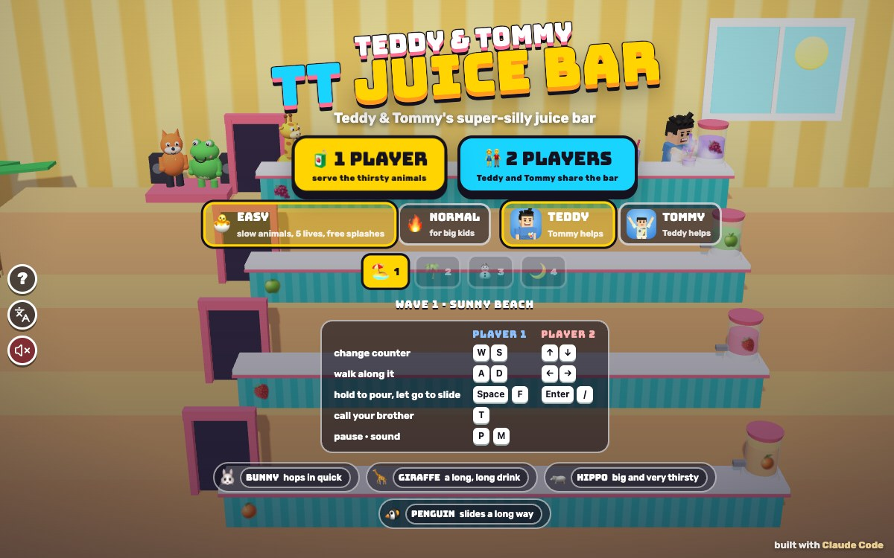

# TT Juice Bar

Press **?** any time (or tap the round **?** button on the left edge) to see the keys. The game waits while you look.
Tap the language button under it (the A文 icon) to switch between English and 中文; the dashboard and every game remember the choice.

**中文：** 果汁吧：四个柜台前挤满了口渴的小动物（小兔子、长颈鹿、河马和企鹅）。上下换柜台，按住倒果汁，松开把杯子推出去；接住小动物推回来的空杯子，走过去捡小费，看 Foxy 和 Froggy 跳舞。单人或 Teddy 和 Tommy 一起看柜台。

An arcade juice-bar game starring Teddy and Tommy, built with Claude Code from plain JavaScript and Three.js on the shared Claude Games kit.
Four counters climb up the room like big steps. Thirsty animals walk in at the far end of each one and head for the juice jugs. You stand behind the counters at the jug end: pour a cup, let go, and it slides down the counter to the first thirsty animal, who slides back while it drinks and then sends the empty cup sliding back to you.
There are no image, model or audio files: the boys are the kit's blocky characters in aprons, the animals and the bar are boxes, spheres and cylinders, every texture is painted on a canvas, and every sound is synthesised.
Nobody gets hurt: served animals float away on a balloon, a big push sends one whooshing out of the door ("WHEEE!"), and an animal that gets all the way to the jug just drinks straight from it ("GLUG GLUG!") and floats off.

The name lives in one place, `JB.TITLE` in `js/title.js` (`JB.ZH` is the 中文 logo, 果汁吧). Change it there (and in the `<title>` of `index.html`) and the logo, the sign on the wall, the menus and the ? panel follow.

## Play

- **Double-click `index.html`.** It works offline because Three.js and the kit are copied into `kit/`. Without internet the title font falls back to Arial Black.
- **Send one file:** `dist/juice-bar-tt.html` is the whole game in one file, about 850 KB. AirDrop or email it, then open it in a browser.
- Rebuild that file after any edit: `python3 kit/tools/bundle.py . --name juice-bar-tt`

Pick **🧃 1 PLAYER** or **👫 2 PLAYERS**, a difficulty, your server (1 player: Teddy or Tommy, and the other brother is your helper) and a wave (any you've reached), then go.

| Difficulty | |
|---|---|
| 🐣 **EASY** (the default), for Tommy (5) | 5 lives (6 shared in 2 players). 4 to 7 slow animals a wave, at most 1 or 2 per counter, each wanting one cup. Splashes are free; only an animal reaching the jug costs a life. Long pushes back, slow empties, quick pouring, tips that wait 9 s. |
| 🔥 **NORMAL**, for Teddy (8) | 3 lives (4 shared). 6 to 12 quicker animals, up to 3 per counter, and hippos (and some others) want two cups. A full cup that runs off the door end, or an empty you miss, is a splash and costs a life. |

## The bar

- **Pouring:** hold the pour key at the jug and the cup fills (about half a second); let go and it slides down that counter. Letting go too early keeps the juice in the cup, so just hold again.
- **Catching:** the first thirsty animal it reaches catches it, slides back toward the door while it drinks, then slides the empty back. An animal pushed right out of the door is served too.
- **Empties:** an empty slides toward the jug end of its counter. Be on that counter (anywhere along it) and you catch it (+100). Nobody there: it falls off the end, SPLASH.
- **Tips:** sometimes an animal leaves a coin on the counter. Walk over it for +250 and a little dance: Foxy 🦊 and Froggy 🐸 dance on their stage and every animal stops to watch for a moment.
- **Lives:** an animal that walks all the way to the jug costs a life (both levels), and on NORMAL so do splashes. Everything waits for a moment, then carries on (a cup you were holding stays in your hand).
- **Waves:** serve every animal to clear the wave. Then the winner does his signature move (Teddy boxes and sinks a 🏀 jump shot, Tommy does his Y pose ✌️), confetti, and the results show the score, the HI-SCORE (one per difficulty), the animals served, the empties caught and the tips, with NEXT WAVE ▶ and ↻ PLAY AGAIN.
- **Four bars:** SUNNY BEACH 🏖️, JUNGLE HUT 🌴, SNOWY CABIN ⛄ and STARRY NIGHT 🌙, then round 2 goes round them again with one more animal and quicker walking.
- **2 players:** Teddy and Tommy share the bar, one server each. They can stand at the same counter. The results say who served the most.

Each counter pours its own juice: orange (bottom), strawberry, apple and grape (top).

## The animals

| | |
|---|---|
| 🐰 **BUNNY** | hops in quick |
| 🦒 **GIRAFFE** | a little slower, a long, long drink |
| 🦛 **HIPPO** | slow and heavy (slides back less), wants two cups on NORMAL |
| 🐧 **PENGUIN** | slides back a long way |

They walk a bit, stop to look around, and walk a bit more, keeping their place in the queue.

## Controls

| | Player 1 | Player 2 |
|---|---|---|
| change counter | W S | ↑ ↓ |
| walk along the counter | A D | ← → |
| hold to pour, let go to slide | Space or F | Enter or / |
| call your brother · high five | T | |
| pause · sound | P or Esc · M | |

In 1 player both sets of keys work. ↑ always goes to the counter above (higher on the screen) and puts you at its jug. On the title: ← → pick 1 or 2 players, ↑ ↓ the difficulty, H the server, V the wave, Enter or Space to start.

**Touch (iPad):** the round pad changes counter (▲ ▼, once per push) and walks (◀ ▶); hold the big 🧃 button to pour and let go to slide. Your brother's face (above the 🧃 button) calls him in. Two players on one iPad: a pad and a 🧃 each, and ✋ in the middle is the high five. The kit's left-edge buttons (?, A文, the speaker) stay clear of the bar and the pads.

## Companion

In 1 player, press **T** (or tap your brother's face) to call the other brother, as often as you like (up to 3 visits line up). He pops up in front of the bottom counter at his small size, does his signature move, tosses you a treat (🍦 💧 🧃 🍪 🍉 🍌: quicker pouring and walking for 8 s, "⚡ FAST"), and then "TOMMY SAYS: JUICE FOR EVERYONE!": he fills a cup and slides one down **every counter at once**. His cups are magic ✨: if nobody catches one, it never costs a life.
In 2 players T is a high five: both servers pour quicker for 6 s.

## How it works, and how it's tested

- `js/sim.js` holds all the rules with no Three.js. `M.step(dt)` runs them in fixed 1/240 s steps whatever the frame rate, so cups slide and stop the same way at any fps. The page (`js/game.js`) only draws the rules' state and turns their events into effects and sounds.
- `node tools/check.js` (under a second) is the headless check:
  1. cups slide and stop by the same rules at any fps: a lone cup, a whole round trip (catch, slide back, drink, the empty back, caught), walking animals, a walking server and the pouring time, at 20, 30, 60, 144 fps and a wobbly frame rate;
  2. animals catch, drink and slide back (every animal, both levels), two-cup animals walk again, the cup goes to the front of the queue, a push past the door serves them, a drinker stops at the animal behind;
  3. empties come back and can be caught, sooner if you walk out to meet them, by moving to their counter in time, and fall off when nobody is there;
  4. splashes cost a life only on NORMAL (full and empty cups), the brother's cups never do, an animal at the jug costs one on both, the pause after a lost life ends, and letting go of a full cup during that pause keeps it in hand (it doesn't slide off later);
  5. a wave ends when every animal is served and not before, plus the autopilot (`js/bot.js`) clearing every wave and round 2 on EASY and NORMAL, 1 and 2 players;
  plus the companion (3 calls, 3 visits, a cup down all 4 counters, the high five in 2 players) and 24,000 frames of random keys that never take a server off the counters.
  `node tools/check.js --soak` adds 3 seeds of every wave with the companion called. The **fail variant** breaks one rule at a time (`JB.SABOTAGE`: cups moving by the frame, no slide back, no empty, empties uncatchable, splashes costing a life on EASY, the wave ending early) and every one is caught.
- `node tools/browser.js check` opens `index.html` from `file://` in headless Chrome (muted) and runs `game.check({ quick: true })` and `game.provePlayCheck()` (`js/playcheck.js`). The play check sends real `keydown`/`keyup` events to `window` and pointer events to the pad and the 🧃 button, lets the game's own loop read them, and measures where the server is drawn on the screen: → right, ← left, ↑ up a counter, ↓ down, on every wave and round 2, 1 and 2 players, arrows and WASD; each brother's keys move only him; pouring fills and the cup slides left on screen; an empty is caught by moving to its counter; walking still works while the pour key is held; the keys come back after a lost life, pause and the ? panel; a "keyboard kid" bashes random keys for 30 s on every wave; touch; T; and a "keys bot" (the autopilot pressing real keys) clears wave 1 on EASY and NORMAL, 1 and 2 players. 287 checks pass; the sabotages `mirror` and `flipRows` (about 20 fails each), `stuckFill` (4) and `stuckOops` (8) all fail it. `node tools/browser.js check file://…/dist/juice-bar-tt.html` runs the same on the single page. No console errors.
- 中文: with `Kit.lang.set('zh')`, `Kit.lang.untranslated()` is `[]` on the title, the ? panel, play, the brother's visit, a thirsty animal, a tip, pause, both results screens and 2 players; a planted string is caught. In English there is no Chinese on the page except the kit's language-button tooltip (on purpose: it names the language a tap switches to).
- `node tools/browser.js shot docs/screenshot.jpg` takes the title at 1200x750.

## Files

- `index.html`: the page, the HUD, the menus and the touch controls.
- `js/title.js` the name · `js/config.js` every number, the four bars, the animals and the juices · `js/sim.js` the rules · `js/bot.js` the autopilot · `js/check.js` the headless check and its sabotages · `js/input.js` keys and touch · `js/sfx.js` the synth sounds · `js/art.js` the 3D toys · `js/game.js` the scene, the camera, the effects, the screens and `window.game` · `js/playcheck.js` the real-key play check · `js/keys.js` the ? panel · `js/zh.js` 中文.
- `tools/check.js` (Node) and `tools/browser.js` (headless Chrome, no npm).
- `kit/`: a copy of `~/claude-games/kit` (`python3 ../kit/tools/sync.py .`); don't edit it here.

## Not verified

- Sound by ear: everything was tested muted; `JB.Sfx.log` shows the sounds firing.
- Real touch devices, iOS Safari, two kids on one iPad, and the iPad home-screen icon (the touch controls were driven with pointer events at 740x360 and 1024x768).
- How hard it really is for a 5- and an 8-year-old: the autopilot clears NORMAL without losing lives, but it reacts instantly.
- Finder double-click (only `file://` in headless Chrome).
- Phone portrait (390x844) works but the bar is small there; the title asks you to turn the phone sideways.
